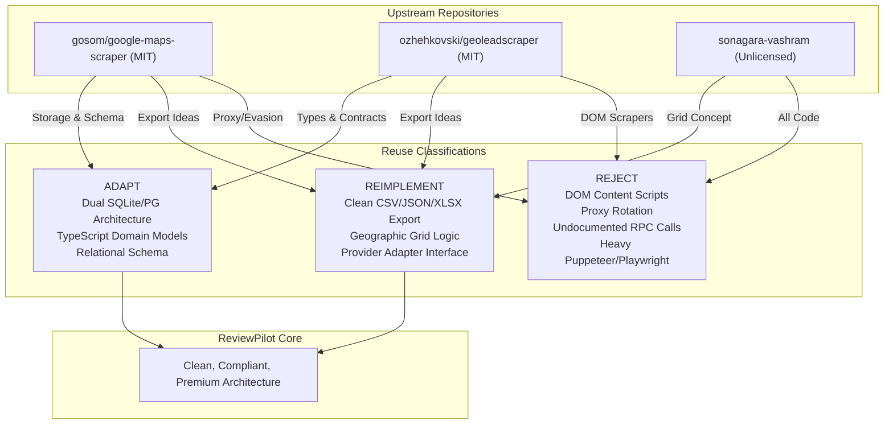

# Component Reuse Decision Matrix

- **Document**: Component Classification & Reuse Decisions
- **Classification Categories**:
  - `REUSE`: Suitable as-is and license-compatible (MIT).
  - `ADAPT`: Useful design or pattern, adapted to fit ReviewPilot architecture.
  - `REIMPLEMENT`: Useful concept, but requires clean-room independent implementation.
  - `REJECT`: Insecure, fragile, unlicensed, or legally unsuitable.

---

## 1. Upstream Component Classifications

| Component | Upstream Source | Classification | Justification & Architectural Strategy |
|:---|:---|:---:|:---|
| **TypeScript Data Models** | `ozhehkovski` (`packages/shared/config.ts`) | **ADAPT** | Adapt TypeScript types for `BusinessLocation`, `Review`, `Reviewer`, and `RatingSummary` into ReviewPilot's unified type definitions. License: MIT. |
| **Dual SQLite / PostgreSQL Storage** | `gosom` (`internal/db/`) | **ADAPT** | Adopt the dual-database architecture: pure Go SQLite (`modernc.org/sqlite`) for zero-config portable desktop mode, PostgreSQL schema compatibility for cloud mode. License: MIT. |
| **Relational Review Schema** | `gosom` (`internal/models/`) | **ADAPT** | Adapt relational table definitions (Places, Reviews, Reviewers, SyncState, ExportJobs) into SQLite/Postgres DDL. License: MIT. |
| **Streaming Multi-Format Exporter** | `ozhehkovski` & `gosom` | **REIMPLEMENT** | Build a clean-room, robust client-side export engine in TypeScript supporting CSV (with RFC 4180 compliance), formatted JSON, and XLSX. |
| **Geographic Grid Partitioning** | `sonagara-vashram` (`grid.py`) | **REIMPLEMENT** | Reimplement the mathematical coordinate bounding box subdivision pattern cleanly in future phases for authorized geo-queries. Code from upstream is unlicensed and rejected. |
| **Browser Extension DOM Content Scripts** | `ozhehkovski` (`gmaps.ts`) | **REJECT** | Fragile DOM selectors break with Google UI updates; violates Google Maps ToS. |
| **Headless Playwright Scraping Engine** | `gosom` (`internal/gmaps/`) | **REJECT** | Heavy binary footprint (>200MB); high risk of IP blocking; violates compliance boundaries. |
| **Reverse-Engineered Protobuf RPC Client** | `sonagara-vashram` (`scraper.py`) | **REJECT** | Unlicensed (All Rights Reserved); fragile undocumented endpoints; violates platform terms. |
| **Proxy Rotation & Header Evasion** | `sonagara-vashram` & `gosom` | **REJECT** | Explicitly out of bounds per ReviewPilot security and data compliance policies. |
| **Admin UI (Go templates / basic HTML)** | `gosom` (`web/`) | **REJECT** | Low UX quality. Replaced with custom commercial-grade React + Vite + Tailwind design system. |
| **Stateless NestJS Backend** | `ozhehkovski` (`apps/api/`) | **REJECT** | High Node.js runtime memory overhead. Prefer native Go backend or client-side local-first execution. |

---

## 2. Summary of Reusable Assets

